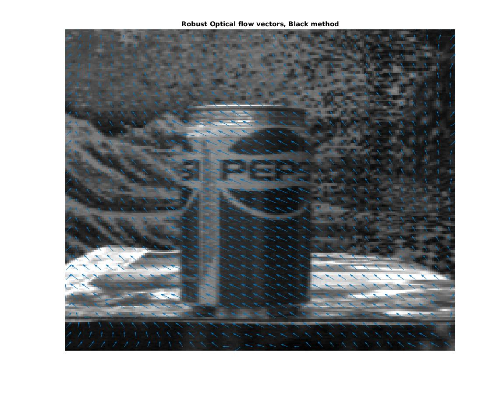

# Black Robust Optical Flow


Helper code used with
[Michael Black's Robust optical flow code](https://cs.brown.edu/people/mjblack/code.html)



## Build

These are C programs

```sh
cmake -B build

cmake --build build
```

## Examples


### Python

```sh
python BlackRobustFlow.py data/pepsi
```

### Matlab

```matlab
[u,v] = BlackRobustFlow('data/pepsi');
```

## Functions

GNC is the C program used for [Robust Estimation of Dense Optical Flow
by Michael
[Black](https://cs.brown.edu/people/mjblack/Papers/cviu.63.1.1996.html).

* `DemoGNC.sh`: terminal script running the dense robust optical flow code
* `BlackRobustFlow.{m,py}`: call GNC from Matlab or Python with user-adjustable parameters
